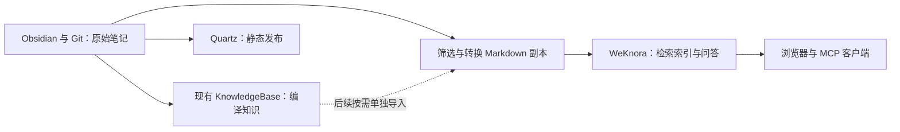

# WeKnora 与 CloudOps Vault 适配评估

## 结论

WeKnora 适合为本仓库增加带原文引用的检索问答入口。继续用 Obsidian 和 Git 编辑、审查、保存笔记，用现有 `KnowledgeBase/` 维护编译知识，用 Quartz 发布文章；WeKnora 从选定内容建立可重建的索引，服务于自然语言查询和跨文档综合。

接入前最值得验证的是检索与引用质量。初次试用选择 30–50 篇运维原文，关闭自动 Wiki、图谱抽取和执行工具。问答效果达到预期后，再实现增量同步，逐步扩大范围。

如果主要需求仍是整理文章、维护双链、改写笔记，现有 Agent 与 Obsidian 工作流已经覆盖核心任务，增加 WeKnora 的收益有限。频繁跨文档查问题，或希望让其他人从浏览器统一查询资料时，它更有价值。

## 评估依据与版本

- 官方项目：[Tencent/WeKnora](https://github.com/Tencent/WeKnora)。
- 查询日期：2026-10-22。GitHub API 当次返回的最新正式 Release 为 [v0.8.3](https://github.com/Tencent/WeKnora/releases/tag/v0.8.3)，发布于 2026-10-14；下文产品判断以此 tag 的文档和相关源码为依据。
- 当次 `main` 为 `92dfa6a1eef2be18df81c2b5fe23bc43e6f3783e`；未把后续开发分支内容当作 v0.8.3 的保证。
- 本仓库在本次归档前，有 873 个被 Git 跟踪且不位于隐藏目录的 Markdown 文件，其中 `KnowledgeBase/` 188 个。此口径包含课程源码附带文档、设计资料副本和导航页，并非 873 篇独立学习文章。
- 同一文件集合中，356 个文件含 `[[`，8 个含 Mermaid 代码块；没有发现 `

| 能力 | 作用 | 对本仓库的意义 |
| --- | --- | --- |
| RAG 文档问答 | 结合关键词与语义检索，经过融合、重排和上下文组装生成带引用的回答 | 将 Kubernetes、Terraform、Kafka、Ceph 等分散笔记按问题组织起来 |
| 多格式解析 | 支持 Markdown、PDF、Office 文档、图片等；具体解析能力取决于部署和模型配置 | 后续可把运维手册、截图与已有 Markdown 放到同一检索入口 |
| Agent | 规划多步任务，调用知识检索、MCP、Skills 和沙箱工具 | 适合后续扩展知识查询流程，第一阶段不需要执行工具 |
| 自动 Wiki | 从资料生成摘要、实体、概念等页面，维护链接、来源引用和版本 | 与本仓库的编译知识层高度重叠，宜先隔离试验 |
| API、CLI、MCP | 支持程序导入、检索，以及向其他 MCP 客户端提供知识能力 | 可让现有 Agent 复用同一套检索索引 |

RAG 的关键词索引适合 `min.insync.replicas`、`reclaimPolicy` 等精确技术词，向量索引适合“副本不足为何拒绝写入”这类语义问题。实际效果仍取决于原文、分块、Embedding、重排与生成模型，需要用本仓库的问题集验证。[RAG 流程](https://github.com/Tencent/WeKnora/blob/v0.8.3/website-docs/02-architecture/04-rag-pipeline.md)、[知识库管理](https://github.com/Tencent/WeKnora/blob/v0.8.3/website-docs/03-features/02-knowledge-base.md)

## 如何与现有项目共存

本仓库已有明确的三层规约，见 [[AGENTS|AGENTS.md]]；编辑和维护入口见 [[KnowledgeBase/entities/Obsidian|Obsidian]]，发布流程见 [[AI/Obsidian/github-pages-quartz|Quartz 发布流程]]。适合采用单向导入：

WeKnora 的索引与自动生成页面有独立的数据模型。本仓库中的 `sources/`、`concepts/`、`entities/`、`maps/`、`analysis/` 和追加式日志属于另一套维护约定。WeKnora 的 Wiki 包含 summary、entity、concept、index、synthesis、comparison 等类型，但不能据此推断它会遵守本仓库 `AGENTS.md`，或自动把内容回写到正确目录。[Wiki 页面模型与流程](https://github.com/Tencent/WeKnora/blob/v0.8.3/website-docs/03-features/14-wiki.md)

建议初期使用一个只包含原始技术笔记的知识库。若后续需要摘要和概念页，可把它们导入另一个知识库，查询时明确范围，避免原文与其摘要同时占据召回结果。WeKnora 生成的 Wiki 也先保留在独立试验库，通过人工审阅决定哪些成果值得进入现有知识层。

## 接入时需要补齐的部分

### 1. 目录上传与持续同步是不同功能

v0.8.3 支持目录递归上传，并保存相对目录结构。CLI 的 `weknora link` 只写入 `.weknora/project.yaml`，让后续命令自动选择知识库；它不启动文件监听。递归上传实现遍历文件、按文件名 glob 筛选并调用创建接口，没有读取 `.gitignore`。[目录上传源码](https://github.com/Tencent/WeKnora/blob/v0.8.3/cli/cmd/doc/upload_recursive.go)、[link 源码](https://github.com/Tencent/WeKnora/blob/v0.8.3/cli/cmd/link/link.go)

正式使用应增加一个小型同步工具：维护“仓库路径 → 内容哈希 → WeKnora 文档 ID → 已同步版本”的记录，分别处理新增、修改、重命名和删除；失败时保留可重试状态。文件重复上传可能返回 409，不能把反复执行全量上传当作更新机制。Markdown 可评估使用手工知识创建/更新接口；普通知识更新接口主要修改元信息，重新解析接口也不等于上传新的源文件。具体路线需在试用阶段验证。[知识 API](https://github.com/Tencent/WeKnora/blob/v0.8.3/website-docs/04-api/02-api-knowledge.md)

已实现的数据源包含 GitLab、Confluence、Notion、飞书等；本次检查的 v0.8.3 连接器清单和目录中没有 GitHub 或 Obsidian 专用连接器。支持 GitLab 同步不能直接视为支持当前 GitHub Vault。[数据源清单](https://github.com/Tencent/WeKnora/blob/v0.8.3/website-docs/03-features/10-datasource.md)

### 2. Obsidian 语义需要转换和样本验证

“支持 Markdown”不代表完整保留 Obsidian 的链接解析、别名、标题锚点、反向链接与关系图。WeKnora 自身生成 Wiki 的链接能力，也不能证明上传原始 Vault 时会自动恢复这些关系。

导出副本应保留标题、技术正文、代码、表格和原始路径；从 frontmatter 提取 `title`、`tags`、`aliases`、日期等信息；按实际 Vault 解析规则处理 `[[路径|显示名]]`、标题锚点和重名笔记，并保留可回溯到本地或 GitHub 的来源标识。转换应使用 Markdown 结构和文件解析结果，避免替换代码块中的示例文本。

图片、远程图床与 Mermaid 应单独验收。源码中看到的 Markdown 解析侧重标准表格和图片处理，不能据此承诺它会渲染 Mermaid、识别所有图形信息，或沿双链读取目标笔记。[Markdown 解析源码](https://github.com/Tencent/WeKnora/blob/v0.8.3/docreader/parser/markdown_parser.py)

### 3. 只导入明确选定的内容

试用导出用目录白名单，先覆盖 Kubernetes 存储、ArgoCD、Kafka、Ceph 和 Terraform 等高价值主题。初期排除 `.git/`、`.obsidian/`、`.claude/`、`.agents/`、缓存、源码快照、大量复制的设计素材、日志、盘点表与导航页。

现有 `tools/site/build.py` 已有网站发布过滤逻辑，但它排除了整个 `KnowledgeBase/`，且用途是发布网站。知识检索的范围应单独定义，可以参考其约定，不能直接把发布集合当作问答集合。

### 4. 回答引用还要连到仓库原文

WeKnora 的回答引用能定位到导入文档或分块。要回到本仓库的准确来源，还应记录原路径与 Git revision，并检查引用是否保留这两个信息；内部文档链接不天然等于本地 Obsidian 链接。

需要穷尽式检查文件引用、批量改名或审计某个字符串时，继续使用本地文件搜索。官方说明 MCP 的 `grep_chunks` 先从索引取有限候选，再匹配正则，不保证找全所有命中。[MCP 检索工具及限制](https://github.com/Tencent/WeKnora/blob/v0.8.3/website-docs/03-features/08-mcp.md)

## 部署与模型成本

| 路线 | 组件与约束 | 建议 |
| --- | --- | --- |
| 标准 Docker Compose | 前端、Go 后端、docreader、ParadeDB/PostgreSQL、Redis；官方建议 4 核 / 8 GB 起步，不含本地模型权重 | 有合适 Linux 测试环境时优先，采用固定 v0.8.3 配置与镜像版本 |
| Lite | 单进程、SQLite FTS5 + sqlite-vec、内存队列；无需独立 PostgreSQL 和 Redis | 适合个人本地使用，但需接受源码构建与解析能力差异 |
| Helm | Kubernetes 部署，可管理持久存储及相关服务 | 问答质量与日常使用价值确认后再考虑 |

本次查询 v0.8.3 Release 的 `assets` 为空；官方文档也标明桌面应用尚未正式提供安装包。因此不能把桌面版当作已可直接下载安装的试用路线。[安装文档](https://github.com/Tencent/WeKnora/blob/v0.8.3/website-docs/01-getting-started/02-installation.md)、[Lite 差异](https://github.com/Tencent/WeKnora/blob/v0.8.3/docs/LITE.md)

本仓库已有 [[AI/企业级私有化大模型/基于K8s部署vLLM和LiteLLM|vLLM 与 LiteLLM 部署资料]]，WeKnora 也支持 LiteLLM、Ollama 和多家模型服务。是否能复用现有服务，需要分别检查聊天模型、Embedding 和可选 Rerank 接口；已有聊天接口不代表这三种能力均可用。本次没有探测任何正在运行的模型端点。

使用远程模型 API 时，WeKnora 服务自身不必运行大模型 GPU 推理；全本地运行的资源则由所选模型另行决定。自托管只说明应用与存储的部署位置：若 Embedding、生成模型或解析服务使用外部 API，相应文本或文件仍会发送到该服务。自动 Wiki 还会增加抽取、合并和维护页面的模型调用量。

## 建议的试用与验收

1. **准备样本**：从 3–5 个主题选 30–50 篇原文，建立导出副本；保留完整技术内容和来源信息。原文件仍是编辑入口。
2. **建立基线**：整理 20 个真实问题，用现有文件搜索与 Agent 工作流记录答案、来源和耗时，再用同一问题集测试 WeKnora。
3. **启动最小功能集合**：固定版本，配置聊天模型与 Embedding，只启用关键词和向量检索；根据结果决定是否增加 Rerank。暂不启用自动 Wiki、Neo4j、沙箱或运维执行工具。
4. **验证价值**：检查回答是否正确引用原文、命令和 YAML 是否完整、跨文档比较是否丢掉条件、资料不足时是否如实说明，同时记录延迟及模型用量。
5. **验证更新再扩展**：修改、重命名和移除试验导出中的一篇文档，检查新内容何时可查、旧内容是否仍被回答。通过后再实现增量同步，或评估内置 MCP Server 的检索接入。

示例问题可以直接取自本仓库：

- 根据 [[Middlewares/Kafka|Kafka]]，`acks=all` 与 `min.insync.replicas` 分别约束什么？ISR 缩小时会发生什么？
- 根据 [[Docker-Kubernetes/k8s-storage/开源存储Ceph|Ceph 笔记]]，`undersized`、`min_size` 与客户端读写有什么关系？
- 比较笔记中的 StorageClass 回收策略与已经存在的 PV，说明变更的生效边界。
- 查找 ArgoCD 同步故障的不同处理条件，要求保留命令参数和适用前提。
- 提出文档未记录的版本或环境问题，观察系统是否把猜测当作本仓库已有事实。

这些是建议的验收方案，尚未执行。是否长期保留 WeKnora，取决于它在这些问题上能否稳定优于当前查询流程，以及同步和运行成本是否可接受。

## 本次验证范围

本次完成官方 Release、相关文档与源码阅读、本地仓库结构及格式扫描，并归档评估。没有安装或启动 WeKnora，没有上传 Vault 内容，没有连接外部模型，也没有测试检索质量、同步行为或模型费用。上文接入设计与试用步骤均为建议。
